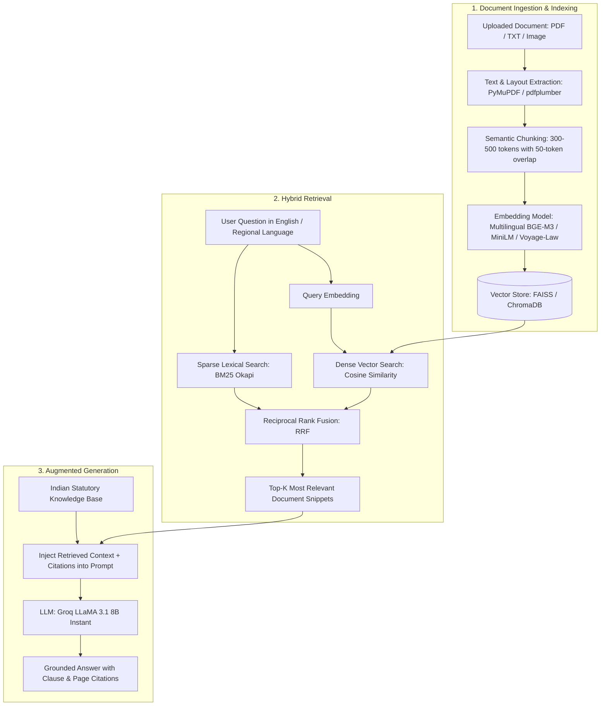

# 🧠 NyayBot RAG (Retrieval-Augmented Generation) Pipeline

This document outlines the architecture, pipeline design, and implementation specification for Retrieval-Augmented Generation (RAG) in **NyayBot**.

---

## 1. Pipeline Architecture Diagram



---

## 2. Step-by-Step Breakdown

### Step 1: Document Ingestion & Layout Extraction
- **Input**: User uploads legal deeds, rental agreements, employment contracts, or interview guides (PDF/Image/TXT).
- **Processing**: Extracts clean text while tracking metadata (Page numbers, Section headers, Character offsets).
- **Tooling**: `pdfplumber`, `PyMuPDF` (fitz).

### Step 2: Semantic Chunking
- **Strategy**: Instead of arbitrary character cuts, documents are divided into logical semantic units (paragraphs, sections, clauses).
- **Parameters**:
  - Chunk Size: ~400 tokens (~300 words).
  - Overlap: 50–75 tokens (ensures context crossing chunk boundaries is not lost).
  - Metadata: `{ "chunk_id": int, "page_no": int, "title": str, "text": str }`.

### Step 3: Multilingual Embedding Generation
- **Requirement**: NyayBot supports 12+ Indian languages (Hindi, Telugu, Tamil, Kannada, Marathi, Bengali, etc.).
- **Recommended Models**:
  - `BAAI/bge-m3` or `sentence-transformers/paraphrase-multilingual-MiniLM-L12-v2` (Local, zero cost).
  - `voyage-law-2` (Dedicated cloud legal embeddings).

### Step 4: Vector Storage & Indexing
- **In-Memory / Session-Based**: `FAISS` (Facebook AI Similarity Search) creates lightweight, millisecond-fast in-memory vector indexes per uploaded document session.
- **Persistent / User History**: `ChromaDB` or `pgvector` for saving indexed documents across sessions.

### Step 5: Hybrid Retrieval (Dense Vector + BM25 Lexical)
Legal documents demand exact precision for numbers and clauses alongside conceptual semantic queries:
- **Dense Vector Search**: Understands meaning (e.g., *"Can I be evicted without warning?"* matches *"Termination with prior written notice"*).
- **BM25 Keyword Search**: Guarantees finding exact numbers and terms (*"₹25,000"*, *"Clause 4.2"*, *"60 days notice"*).
- **Score Fusion**: `Score = 0.5 * BM25_score + 0.5 * Dense_Cosine_score`.

### Step 6: Grounded Generation with Citations
- **Prompt Construction**:
  ```text
  You are NyayBot, an AI legal clarity assistant.
  Answer the user's question using ONLY the retrieved clauses below.
  When stating any term, obligation, or deadline, cite the exact source using [Page X, Clause Y].
  If the retrieved context does not answer the question, state so honestly.
  ```
- **Output**: Returns the synthesized plain-language answer accompanied by structured citation references.

---

## 3. Comparison: Naive Truncation vs. True RAG

| Dimension | Current Naive Implementation | True RAG Pipeline |
| :--- | :--- | :--- |
| **Document Length** | Truncates after first 6,000 chars (~1,000 words) | Handles 100+ pages without truncation |
| **Accuracy** | Misses clauses past page 2 | Searches the entire document corpus |
| **Hallucination Rate** | Higher on long or detailed documents | Low (strictly grounded in retrieved passages) |
| **Source Attribution** | Cannot pinpoint exact clause or page number | Provides clickable inline citations |
| **Multi-Lingual** | Dependent entirely on LLM translation | Multilingual embedding retrieval across languages |
